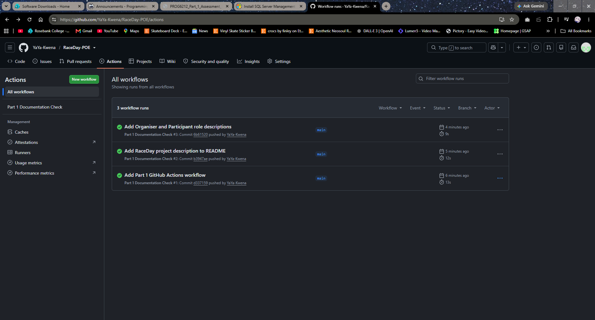
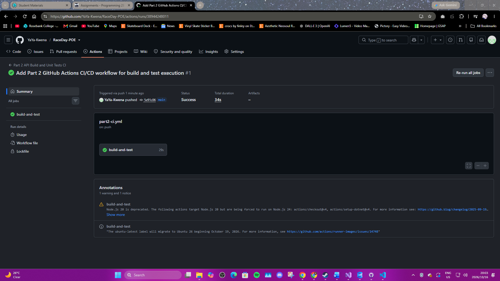

# RaceDay Event Management System (PROG6212 POE)

## Project Description
RaceDay is a full-stack web-based event management platform designed for the South African road running, walking, and cycling community (supporting iconic events such as the Comrades Marathon, Soweto Marathon, and Cape Town Cycle Tour). It replaces paper-based registration and spreadsheets with a structured relational database and role-based RESTful API[cite: 19, 38].

---

## User Roles
### 1. Organiser
* Can register and log in with server-side session authentication[cite: 38, 39].
* Can create, update, and delete RaceDay events (capturing event name, description, date, start time, city/province, primary distance in km, and event type: Running, Walking, or Cycling)[cite: 20, 39].
* Can create, update, and delete age and distance categories and routes for events[cite: 20, 39].
* Can view all participant enrolments for their events[cite: 20, 39].
* Can capture and update official finish times and positions for enrolled participants[cite: 20, 39].

### 2. Participant
* Can register an account with a hashed password and log in using server-side session authentication[cite: 38, 39].
* Can view and update their personal profile, emergency contacts, and medical conditions.
* Can browse all upcoming events, routes, and categories[cite: 19, 20, 39].
* Can enrol into an event by selecting a specific category[cite: 20, 39].
* Can view their own event enrolments and track their personal race results and performance history[cite: 20, 39].

---

## Repository Structure
* `/docs` — Contains Part 1 planning deliverables (`RaceDay_ERD.pdf`, `RaceDay_API_Endpoint_Plan.md`, and `RaceDay_Database.sql`) updated with Part 1 lecturer feedback[cite: 27, 43].
* `/src/RaceDay.API` — ASP.NET Core 8.0 Web API project using Entity Framework Core (Code-First), server-side session authentication, and Swagger UI[cite: 38, 39].
* `/src/RaceDay.Tests` — xUnit automated unit test project testing registration, login, organiser event management, role-based access rejection, and participant enrolments[cite: 39].
* `/.github/workflows` — GitHub Actions CI/CD workflows validating documentation, building the API, and running all unit tests on every push[cite: 33, 40].

---

## Part 2 Setup and Run Instructions

### Prerequisites
* .NET 8.0 SDK
* SQL Server LocalDB (`(localdb)\MSSQLLocalDB`) or SQL Server Management Studio (SSMS)
* Visual Studio 2022 or Visual Studio Code

### Running the API and Swagger UI
1. Clone the repository:
   ```bash
   git clone [https://github.com/YaYa-Kwena/RaceDay-POE.git](https://github.com/YaYa-Kwena/RaceDay-POE.git)
   cd RaceDay-POE

## Database Setup Part 1
1. Open SSMS and connect to a clean SQL Server instance.
2. Open `RaceDay_Database.sql` from the `/docs` folder.
3. Execute the script to generate tables, constraints, and seed data.

## CI/CD
The GitHub Actions workflow checks that the required Part 1 files exist in the correct directories.



## Video Demonstration
YouTube Link Part 1: [https://youtu.be/bvNNprHwpd8]
YouTube Link Part 2: [https://youtu.be/aaRnCwIw5CE]